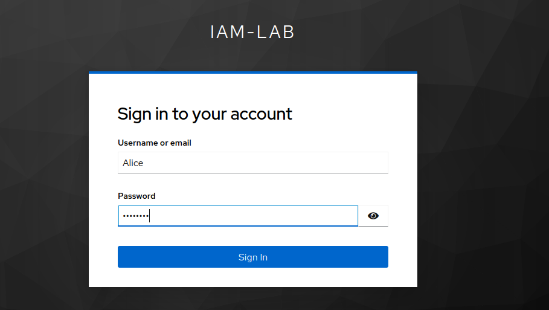
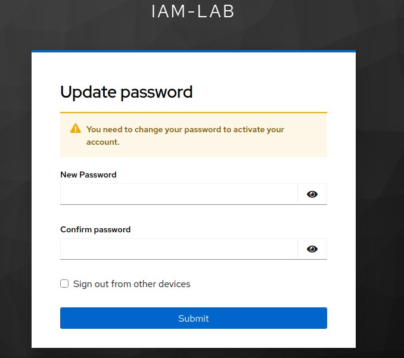
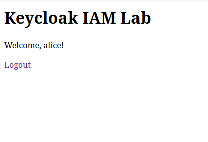
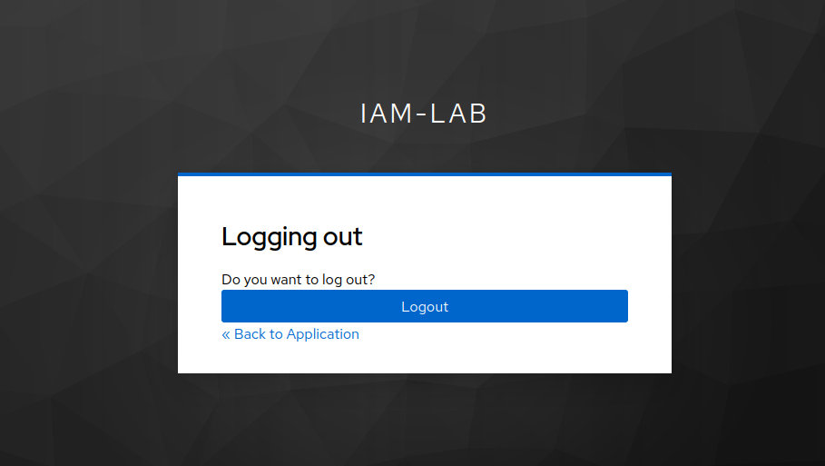

# Keycloak IAM Lab

A hands-on Identity and Access Management (IAM) learning project using **Keycloak, PostgreSQL, Docker Compose, and Flask**.

The purpose of this lab is to explore identity management, authentication, and OpenID Connect (OIDC) by integrating a self-hosted Keycloak identity provider with a small Flask application.

## Project Overview

This project demonstrates how an application can delegate user authentication to a centralized identity provider instead of managing user credentials itself.

Keycloak handles authentication, while the Flask application acts as an OIDC client.

The lab currently includes:

- Keycloak running in Docker.
- PostgreSQL as the Keycloak database.
- A dedicated Keycloak realm for the lab.
- An OIDC client configured for the Flask application.
- A test user for authentication.
- A Flask application implementing login, callback, user session, and logout functionality.

## Architecture

```text
                 Browser
                    |
                    v
             Flask Application
              localhost:5000
                    |
                    | OpenID Connect
                    v
                 Keycloak
              localhost:8081
                    |
                    v
                PostgreSQL
              Docker network
```

## Technologies

| Technology | Purpose |
|---|---|
| Keycloak | Identity and access management |
| PostgreSQL | Persistent Keycloak database |
| Docker Compose | Container orchestration |
| Flask | Python web application |
| Authlib | OAuth 2.0 and OIDC integration |
| Python | Application development |

## Keycloak Configuration

The lab uses the following configuration:

| Setting | Value |
|---|---|
| Realm | `iam-lab` |
| Client ID | `iam-lab-app` |
| Client type | OpenID Connect |
| Client authentication | Enabled |
| Standard flow | Enabled |
| Test user | `alice` |

The Flask application uses Keycloak's OpenID Connect discovery endpoint to obtain provider configuration.

## Authentication Flow

The current authentication flow works as follows:

1. The user opens the Flask application.
2. The user selects **Login with Keycloak**.
3. Flask redirects the browser to Keycloak.
4. The user authenticates with their Keycloak account.
5. Keycloak redirects the browser to the Flask callback URL with an authorization code.
6. Flask exchanges the authorization code for tokens.
7. Flask retrieves user information and creates an application session.
8. The authenticated user is welcomed by the Flask application.

The application also provides a logout endpoint that clears the Flask session and redirects the user to Keycloak's logout endpoint.

## Screenshots

### 1. Keycloak Login

The user is redirected to Keycloak to authenticate.



### 2. Required Password Update

Keycloak requires the user to update their password before continuing.



### 3. Successful Authentication

After successful authentication, the Flask application displays the authenticated user.



### 4. Logout Confirmation

The user is redirected to Keycloak's logout confirmation page.



## Security Considerations

This project is intended for local learning and experimentation.

- Secrets are stored in `.env`, not directly in application code.
- `.env` is excluded from Git using `.gitignore`.
- PostgreSQL is accessible only through the internal Docker network.
- Keycloak is bound to localhost.
- Flask is configured to bind to localhost.
- Keycloak currently uses development mode (`start-dev`).

**This configuration is not intended for production deployment.**

Production environments require additional security measures, including HTTPS, secure cookie settings, production Keycloak configuration, secret management, and appropriate deployment hardening.

## Learning Objectives

The lab is intended to explore:

- Identity and Access Management (IAM)
- Identity providers (IdP)
- OpenID Connect (OIDC)
- OAuth 2.0 authorization flows
- Authentication and user sessions
- Token handling
- Single Sign-On (SSO)
- Docker-based infrastructure

## Roadmap

Planned improvements:

- [ ] Improve logout using ID token hints.
- [ ] Add role-based access control (RBAC).
- [ ] Explore client scopes and protocol mappers.
- [ ] Implement PKCE.
- [ ] Explore token validation and expiration.
- [ ] Add screenshots and technical documentation.
- [ ] Add automated tests.
- [ ] Explore production-ready Keycloak configuration.

---

**Status:** Work in progress — personal IAM learning lab.
